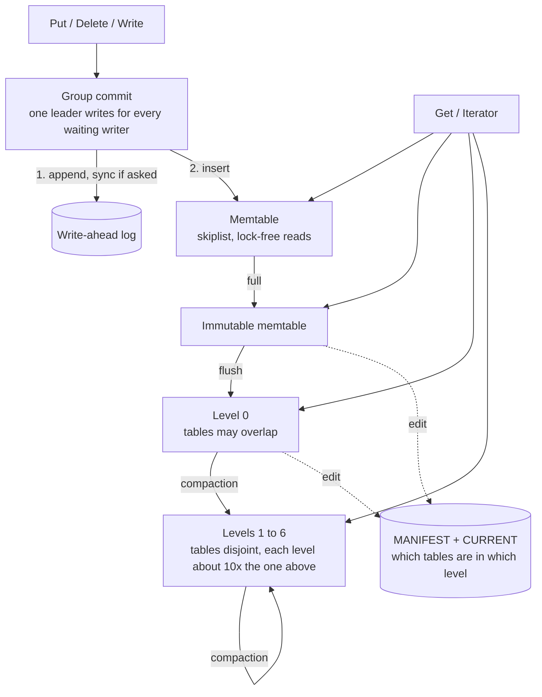

# lsm

An embedded, single-process, persistent ordered key-value store in C++20. It
is a log-structured merge tree in the shape of LevelDB, written from scratch:
write-ahead log with group commit, skiplist memtable, sorted tables with
bloom filters, leveled compaction, snapshots, and iterators.

It exists to back six claims with tests, and to be measured honestly against
LevelDB and RocksDB.

| operations per second | lsm | LevelDB | LevelDB, checksums off | RocksDB |
|---|---:|---:|---:|---:|
| fillseq | 524k | 470k † | 477k † | 476k † |
| fillrandom | 267k | 248k † | 231k † | 281k † |
| fillsync (every write synced) | 351 | 339 | 336 | 350 |
| readrandom | 163k | 172k † | 193k † | 160k † |
| readmissing | 508k | 344k † | 644k † | 438k † |
| readseq | 4.14M | 9.62M † | 13.9M † | 4.76M † |
| seekrandom | 52k | 244k † | 345k † | 77k † |

Five million entries, 16-byte keys, 100-byte values, median of three runs,
warm page cache, on an Apple M3 Pro laptop with APFS. **Read this table for
its large differences only.** Other programs were running on the machine, and
in every cell marked † one of the three runs was two to four times slower
than the others. The full results, with the range of each cell, are in
[bench/results/2026-10-02/report.md](bench/results/2026-10-02/report.md).

What survives the noise:

- **Writes and point reads are in the same range as both engines.**
- **Forward scans are 2.3 times slower than LevelDB's, and random seeks about
  5 times slower.** This engine reads every block with `pread` and checksums
  it; LevelDB maps the file and, by default, does not checksum.
- **Short scans over heavily updated keys are 18 times slower than
  RocksDB's** (YCSB workload E, not in this table).

Each loss is explained, with the experiment that checks the explanation,
under [Measurements](#measurements).

## The six claims

| # | Claim | How it is shown |
|---|---|---|
| 1 | **It survives a crash at any point.** | 50,000 simulated power failures, each at a random file operation, including inside flushes, compactions, and manifest switches. After every one the database reopens, holds every acknowledged synced write, and is a prefix of the write history. Removing any one of the eight syncs makes the loop fail. [`CrashLoop.EveryAcknowledgedSyncWriteSurvivesAndStateIsAPrefix`](test/crash_loop_test.cc), [`ProcessCrash.AcknowledgedWritesSurviveSigkill`](test/process_crash_test.cc), [`mutation_check.py`](test/tools/mutation_check.py) |
| 2 | **It detects corruption rather than returning wrong data.** | Every block read verifies a checksum; there is no switch to turn that off. Flipping each of the 10,024 bits of a table file in turn: 9,759 flips are reported as corruption, 265 change nothing a reader sees (footer padding and one non-canonical varint), none returns wrong data. A flipped bit in a log, a manifest, or `CURRENT` fails `Open`. Five decoders are fuzzed. [`TableTest.EverySingleBitFlipIsDetectedOrHarmless`](test/table_test.cc), [`BitFlip.EveryReadIsCorrectOrReportsCorruption`](test/bitflip_test.cc), [`fuzz/`](fuzz) |
| 3 | **Snapshots are isolated from compaction.** | A snapshot keeps reading its value after the key is overwritten, deleted, and compacted to the bottom. A long-lived iterator survives heavy compaction and none of its files is deleted under it. [`DBTest.SnapshotSeesItsValueAfterOverwriteDeleteAndCompaction`](test/db_test.cc), [`DBCompactionTest.LongLivedIteratorSurvivesHeavyCompaction`](test/db_test.cc) |
| 4 | **Compaction never drops a visible key.** | In debug builds every compaction's output is re-read and compared with its input at every live snapshot before it is installed; a difference aborts. Deliberately breaking the tombstone rule or the snapshot rule trips it. [`compaction_check.cc`](src/db/compaction_check.cc), [`CompactionCheck.*`](test/compaction_check_test.cc), [`DBTest.TombstoneIsKeptWhileADeeperLevelHoldsTheKey`](test/db_test.cc), [`DBCompactionTest.FullScanEquivalenceWithAModelAfterEveryStep`](test/db_test.cc) |
| 5 | **It is measured against LevelDB and RocksDB.** | Same machine, same settings, three runs of each, medians with the range shown, and an explanation for each loss. The published run was disturbed by other work on the machine, which the results mark cell by cell. [Measurements](#measurements) below, raw data in [`bench/results/`](bench/results). |
| 6 | **It is clean under ASan, UBSan, and TSan.** | All 296 tests pass under ASan+UBSan and under TSan, on macOS with clang 23 and on Linux with g++ 13 and clang 18 (LeakSanitizer included). A 16-thread stress test against per-thread models ran for 600 seconds under TSan: 10.6 million operations, no reports. [`Stress.SixteenThreadsAgainstPerThreadModels`](test/stress_test.cc) |

What has not been verified is listed under [Limits](#limits).

## Using it

```cpp
#include "lsm/db.h"

lsm::DB* db = nullptr;
lsm::Status s = lsm::DB::Open(lsm::Options(), "/tmp/example", &db);

lsm::WriteOptions durable;
durable.sync = true;                       // survives power loss once it returns
s = db->Put(durable, "key", "value");

std::string value;
s = db->Get(lsm::ReadOptions(), "key", &value);

const lsm::Snapshot* snapshot = db->GetSnapshot();
lsm::ReadOptions at_snapshot;
at_snapshot.snapshot = snapshot;
std::unique_ptr<lsm::Iterator> it(db->NewIterator(at_snapshot));
for (it->Seek("k"); it->Valid(); it->Next()) { /* it->key(), it->value() */ }
s = it->status();                          // a scan that hit corruption says so here
it.reset();
db->ReleaseSnapshot(snapshot);
delete db;
```

Every fallible call returns a `[[nodiscard]] Status`. The API is LevelDB's in
shape: `Put`, `Delete`, `Write(WriteBatch)`, `Get`, `NewIterator`,
`GetSnapshot`, `GetProperty`, `CompactRange`.

## Building and testing

```sh
cmake --preset release && cmake --build --preset release
ctest --preset release

cmake --preset debug && cmake --build --preset debug && ctest --preset debug
cmake --preset asan  && cmake --build --preset asan  && ctest --preset asan    # ASan + UBSan
cmake --preset tsan  && cmake --build --preset tsan  && ctest --preset tsan
```

Needs CMake 3.24 or later, Ninja, and a C++20 compiler. GoogleTest and Google
Benchmark are fetched at configure time.

On macOS, configure the sanitizer and fuzzer presets with Homebrew's clang.
Binaries built with Apple clang 17's sanitizer runtimes hang at startup on
macOS 26, and Apple clang ships no libFuzzer:

```sh
brew install llvm
CXX=/opt/homebrew/opt/llvm/bin/clang++ cmake --preset asan
```

### On Linux, in Docker

The image is the CI environment: Ubuntu 24.04, g++ 13, clang 18, CMake 3.28,
plus LevelDB 1.23 and RocksDB 8.9 for `db_bench`.

```sh
docker build -t lsm . && docker run --rm lsm      # g++, debug preset, every test
docker run --rm -e CXX=clang++ -e PRESET=asan lsm  # any compiler and preset

docker compose run --rm gcc                        # the same, with the checkout mounted
docker compose run --rm -e PRESET=tsan clang
docker compose run --rm clang bash                 # a shell
```

`docker run` builds the copy of the source baked into the image. `docker
compose` mounts the checkout instead, so edits on the host are picked up, and
keeps each compiler's build trees in a volume of its own, since the host's
`build/` holds macOS binaries.

Two things the container does not give you. On Apple Silicon the image is
arm64, so the x86 SSE4.2 checksum path is still not exercised. And under
Docker Desktop the engine runs in a virtual machine on a virtual disk, so
`db_bench` numbers from it describe that VM; benchmark on a Linux host.
RocksDB is also 8.9 here and 11.8 under Homebrew, so results from the two
are not comparable.

### Long runs

The long runs behind the numbers in the claims table:

```sh
LSM_CRASH_CYCLES=50000 build/debug/lsm_tests --gtest_filter='CrashLoop.*'
LSM_BITFLIP_PER_FILE=400 build/debug/lsm_tests --gtest_filter='BitFlip.*'
LSM_DB_STRESS_SECONDS=600 build/tsan/lsm_tests --gtest_filter='Stress.*'
python3 test/tools/mutation_check.py
```

## How it works



**Writes.** Writers queue. The one at the head becomes the leader, merges the
batches behind it into one, appends that to the log as a single record, syncs
once if any of them asked for it, applies it to the memtable, and wakes the
rest. When the memtable reaches `write_buffer_size` it becomes immutable and
a new one, with a new log, takes over.

**Flush and compaction.** One background thread writes the immutable memtable
out as a level-0 table, and merges tables downwards when a level is over its
size. A compaction keeps, for each key, the newest version and every version
a live snapshot can still see, and drops a deletion marker only when no
deeper level can hold the key. Output tables are cut only between user keys,
so levels 1 and below never hold one key in two tables. If the background
thread falls behind, writers are slowed and then stopped, and the time they
wait is counted.

**Reads.** A `Get` checks the memtable, the immutable memtable, every level-0
table whose range covers the key (newest first), then at most one table per
deeper level, found by binary search. Each table's bloom filter is consulted
before any of its data blocks is read. Blocks come through a sharded LRU
cache. An iterator merges all of these sources through a heap and hides
versions the reader's snapshot cannot see.

**Recovery.** `Open` replays the manifest to learn which tables exist, then
replays the logs that were not yet flushed. [docs/durability.md](docs/durability.md)
has the rules; [docs/format.md](docs/format.md) has every byte layout.

## Measurements

`bench/db_bench` runs the LevelDB workloads and a YCSB-style mix against this
engine, LevelDB 1.23, and RocksDB 11.8, each opened with the same write
buffer (64 MiB), block cache (8 MiB), block size, bloom bits, and no
compression. LevelDB runs twice: verifying block checksums on reads, as the
other two do, and with its default of not verifying. `bench/run_all.sh` runs
everything and `bench/report.py` turns the raw output into
[the full report](bench/results/2026-10-02/report.md): throughput, p50, p99,
and p99.9 latency, bytes written and read, and stall time for every
benchmark.

**How far to trust this run.** It was made on a laptop on battery, with other
programs using the CPU for part of it. For each of the other three engines, one run in
three was two to four times slower than the other two. The report shows the
median and the range of every cell and marks the cells whose runs disagree by
more than 2×. Differences below about 1.5× mean nothing here. The page cache
was not dropped, so nothing below says anything about cold reads. To repeat
it on an idle machine:

```sh
caffeinate -i bash bench/run_all.sh        # about two hours; plugged in, nothing else running
python3 bench/report.py bench/results/$(date +%F)
```


### Where it loses, and why

**Forward scans: 4.1M entries a second against LevelDB's 9.6M, or 13.9M with
its checksums off.** A profile of `readseq` shows the time going to `pread`
and CRC32C. Every 4 KiB block that is not in the block cache costs a system
call, a copy into a fresh buffer, and a checksum. LevelDB maps table files
into memory, so a block is a pointer into the page cache, and the gap between
its two columns is what the checksum alone costs it. RocksDB, which also
reads with `pread` and verifies, is at 4.8M. This is the price of the
`pread` decision below, paid knowingly.

**Random seeks: 52k a second against LevelDB's 244k and RocksDB's 77k.** A
seek positions an iterator in every sorted run that could hold the key, and
each of those reads a data block. Two experiments on a million keys separate
the causes:

| | median seek |
|---|---:|
| three sorted runs, 8 MiB block cache | 11.8 µs |
| three sorted runs, block cache large enough for everything, warm | 3.7 µs |
| compacted to one sorted run, 8 MiB block cache | 3.6 µs |

So the cost is the number of runs times an uncached block read. LevelDB is
ahead on both counts. Its blocks are mapped, and it compacts a file after
enough seeks pass through it: during the read-only `readrandom` benchmark
that precedes this one, LevelDB wrote about 820 MB of compaction output and
the other two engines wrote nothing, so LevelDB runs `seekrandom` on a
flatter tree. What to build: seek-triggered compaction, and a block cache
default that is not 1.5% of the data.

**Short scans after updates (YCSB E): 2.7k a second against RocksDB's 49k.**
LevelDB is at 8k to 11k. The iterator steps over every obsolete version of a
key one at a time. In this harness the popular keys of the zipfian
distribution are adjacent, so a scan that starts on one crosses the most
overwritten keys in the database. On a million keys, the median scan takes
13 µs on a freshly loaded database and 27 µs after one round of YCSB A, and
the 99th percentile goes from 41 µs to 463 µs. RocksDB gives up stepping
after a few versions and seeks past the rest. That is a small change to
`DBIter` and the first thing to build next.

**Writing 4 KiB values: 52k a second against RocksDB's 123k.** Not
investigated. RocksDB flushes and compacts on several threads and this engine
has one, which would explain it, but that has not been checked.

**Cold reads.** Not measured. The expectation is a loss to RocksDB, which
partitions its indexes and filters and reads ahead.

### Where it holds

Sequential and random writes, overwrites, point reads, and reads of missing
keys are all within the noise of LevelDB and RocksDB. Synced writes are the
same in every engine, 340 to 350 a second, because each one waits about 3 ms
for `F_FULLFSYNC`.

### Group commit


6,400 writes, each synced, split across more and more threads. With one sync
per write, throughput is pinned at what the drive can sync: about 338 a
second however many threads wait. With group commit, the writers that queue
up while one sync is in flight are written and synced together by the next
leader, and 64 threads reach 8,100 a second, 24 times as many.

| threads | group commit | one sync per write |
|---:|---:|---:|
| 1 | 338 | 338 |
| 2 | 392 | 340 |
| 4 | 779 | 339 |
| 8 | 1,520 | 338 |
| 16 | 3,020 | 338 |
| 32 | 5,330 | 335 |
| 64 | 8,100 | 333 |

### Write amplification against the level size multiplier


Two million entries (232 MB) are loaded into a tree with a 1 MiB write buffer
and a 1 MiB first level, then overwritten once. The chart counts every byte
written during the overwrite, per byte of user data, and where it went.

The result is nearly flat: 10.2 to 10.8 across multipliers 4 to 16. The
textbook expectation is that a larger multiplier costs more. The breakdown
shows why it does not here:

| multiplier | levels in use | log + flush | into level 1 | into level 2 | into level 3 | into level 4 and deeper | total |
|---:|---:|---:|---:|---:|---:|---:|---:|
| 4 | 5 | 2.15 | 1.25 | 1.63 | 2.43 | 2.70 | 10.16 |
| 8 | 4 | 2.15 | 1.26 | 2.97 | 3.81 | 0.21 | 10.40 |
| 10 | 4 | 2.15 | 1.25 | 3.41 | 3.55 | 0.00 | 10.36 |
| 16 | 3 | 2.15 | 1.25 | 4.76 | 2.65 | 0.00 | 10.82 |

- A larger multiplier makes each step down more expensive (level 2 costs 1.63
  at multiplier 4 and 4.76 at 16) and needs fewer steps. At this data size
  the two effects cancel.
- 3.4 of the 10 do not depend on the multiplier at all: the log, the flush,
  and level 1, whose cost is set by how many memtables pile up in level 0
  before they are merged.
- The deepest level is only part full, so the last step costs less than the
  multiplier suggests.

The right-hand panel repeats the overwrite at 8,000 writes a second, slow
enough that no write ever stalls. Write amplification is higher there, 11.1
to 12.0. That is consistent with a tree that falls behind being cheaper to
write to: upper levels run over their targets, the size ratios between levels
shrink, and each merge rewrites less. The debt is paid by readers, who see
more sorted runs, and by writers, who stall. The paced run at multiplier 16
is missing because the machine was suspended during it.

### Space amplification


Two million entries are written in order and then overwritten three times in
random order. The directory settles at 1.6 times the size of the live data
and peaks at 1.67. The excess is overwritten versions that have not yet been
merged into the deepest level, plus the log.

### Table files consulted per Get


After five million random writes have settled, a key's range is covered by
four or five tables: one per level that holds data, and any level-0 tables. A
read of a key that does not exist has to ask all of them, and the bloom
filters answer without a data block being read, which is why `readmissing`
is three times faster than `readrandom`. A read of a key that exists stops at
the first table that has it.

### Microbenchmarks

`build/release/micro_bench` times the primitives underneath with Google
Benchmark: CRC32C on the hardware and portable paths, memtable insert and
lookup, a seek within a block, a bloom probe, and a block cache lookup from
one and eight threads.

## Design decisions

**`pread`, not `mmap`, for table reads.** With `pread`, an I/O error is a
return code. The fault-injection environment can produce one on any read and
the tests can check that it surfaces as a `Status`. With `mmap`, an I/O error
is a `SIGBUS` in whatever code touched the page, which the engine cannot turn
into a `Status` and the tests cannot inject. The cost is a system call and a
copy for every block that misses the block cache, and it is visible in the
scan and seek numbers above.

**Every block read verifies its checksum.** LevelDB makes this an option and
leaves it off by default. Here it is unconditional, because claim 2 is not
true otherwise. The comparison runs LevelDB both ways to show what it costs.

**Leveled compaction only.** Leveled compaction keeps one sorted run per
level, which bounds a point read to one table per level and keeps space
amplification low. It pays in writes: data is rewritten each time it moves
down a level. Size-tiered compaction makes the opposite trade. The write
amplification section above measures what the trade costs here.

**One bloom filter per table.** One probe decides whether a table can hold a
key. LevelDB builds a filter per 2 KiB of data; RocksDB can partition filters
and keep only the hot partitions in memory. With whole-file filters, the
filter of every table a read consults has to be in memory, which is fine at
this scale and would not be at a terabyte.

**Skiplist memtable.** Readers take no lock: nodes are published with an
atomic store and never removed. That is the property TSan is asked to check.

**A single background thread.** Flushes take priority over compactions by
interrupting them. All work enters through one scheduling function and every
version change goes through `VersionSet::LogAndApply` under the mutex, which
is where a thread pool would attach.

**No compression.** The block trailer reserves a type byte and any value but
"none" is reported as corruption.

### Bloom filter false positive rate

Measured by [`FilterBlock.FalsePositiveRateTable`](test/filter_block_test.cc):

| bits per key | probes | theory | measured, 20,000 keys | measured, 1,000,000 keys |
|---:|---:|---:|---:|---:|
| 4 | 2 | 15.48% | 15.47% | 15.45% |
| 6 | 4 | 5.61% | 6.25% | 8.46% |
| 8 | 5 | 2.17% | 2.30% | 3.14% |
| 10 | 6 | 0.84% | 0.91% | 1.27% |
| 12 | 8 | 0.31% | 0.36% | 0.47% |
| 16 | 11 | 0.05% | 0.05% | 0.07% |

At a million keys the filter is about 1.5 times worse than theory. The probe
positions come from one 32-bit hash by double hashing, as in LevelDB, and
with that few hash bits the probe sequences of different keys collide more
often as the filter grows. Deriving the two hashes from a 64-bit hash would
close the gap. It has not been done, because it changes the on-disk format
and a table here holds far fewer than a million keys.

## Limits

Not built, by design: transactions beyond `WriteBatch`, column families,
range deletes, compression, compaction styles other than leveled, more than
one process per database.

Not verified:

- **Linux on x86.** The engine was developed and measured on macOS. On Linux
  it has been built and tested only on arm64, in the Docker image above:
  every test passes with g++ 13 and clang 18 under the debug, release,
  ASan+UBSan, and TSan presets. The x86 SSE4.2 checksum path has never been
  compiled. The CI workflow in
  [`.github/workflows/ci.yml`](.github/workflows/ci.yml) covers it and has
  not run, because the repository has no remote yet.
- **A clean comparison run.** The published benchmark run shared the machine
  with other work, and the laptop was suspended during its last few steps.
  The results mark what that touched. It should be repeated on an idle
  machine, and on Linux, before any number here is quoted.
- **Cold-cache reads.** The page cache was not dropped between benchmarks, so
  every read number is a warm-cache number.
- **Real power loss.** Crash testing simulates the filesystem. It models
  unsynced data, unsynced directory entries, and torn writes; it does not
  model a drive that acknowledges a flush it did not perform.

One test run under GCC timed out once (the model test, after 434 seconds) at
a moment when the system clock jumped, which suggests the machine slept. It
did not recur in 96 parallel reruns and two full suite runs.

## Documents

- [docs/format.md](docs/format.md): byte layouts of the log, tables, and manifest.
- [docs/durability.md](docs/durability.md): what a successful write promises and why.
- [docs/buildlog-manifest-after-failed-write.md](docs/buildlog-manifest-after-failed-write.md):
  the bug where a write after a failed write destroyed the manifest.
- [docs/spec.md](docs/spec.md): the specification this was built from.
